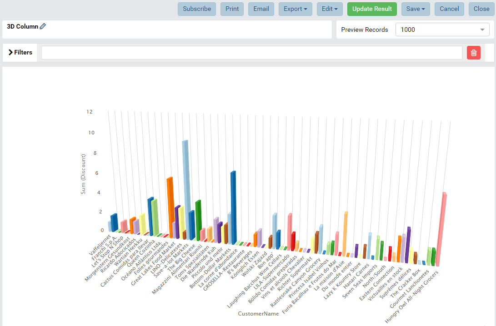
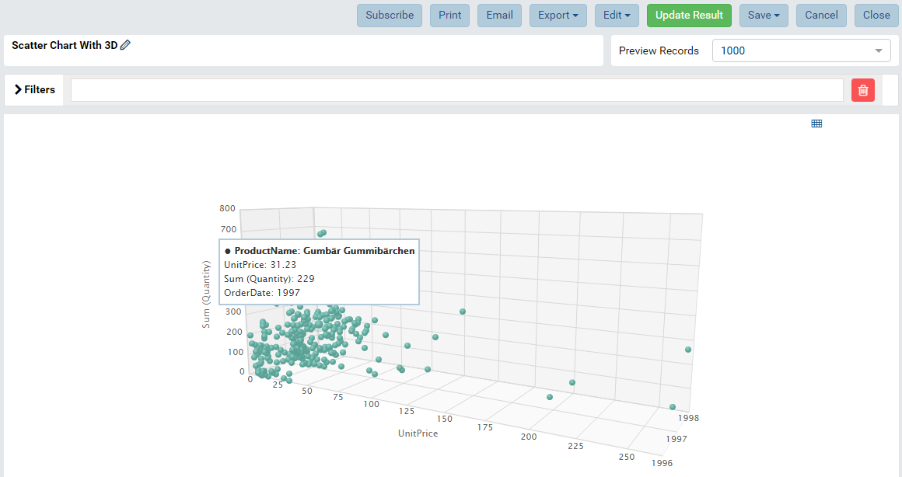
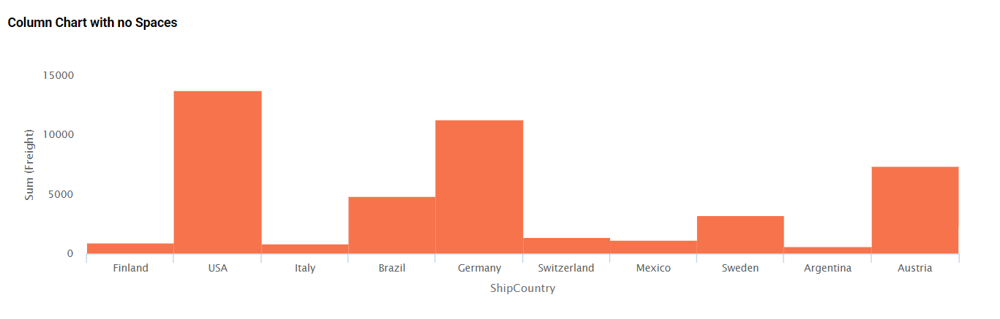

# Izenda Custom Visualizations 

> _Note that this example is meant to demonstrate the flexibility of the Izenda JS API to adopt the various requirements on building a custom chart._

This repo contains code examples showing how to customize or extend the Izenda visualizations using JS APIs. It is based on original 3D Highcharts examples at https://www.highcharts.com/docs/chart-concepts/3d-charts

- 3D Column chart (/src/3d_column) demonstrates the ability of extending a column chart by adding an "Enable 3D" checkbox option into the property panel of the report designer.
  
- 3D Scatter chart (/src/3d_scatter) demonstrates the ability of extending a scatter chart by adding an additional field container (Z-Axis Values) and rendering the scatter plot in a 3 dimensional chart.
  
- Column No Space (/src/columnnospace) demonstrates the ability of extending a column chart by altering the padding between the columns to show no space between the groupings.
  
- D3 Timeline (src/d3_timeline) demonstrates the ability of implementing a timeline chart using D3.js.
- Google Map (src/d3_googlemap) demonstrates the ability of implementing a custom Map visualization using Google Map api.

### Installation

- Download EmbeddedUI.zip in Izenda download site and extract into libs/IzendaSynergy folder
- Change the WebAPIUrl value to Izenda Standalone BE API in /src/config.js
- Run following npm command

```
npm install
```

> **Note:** The `--openssl-legacy-provider` flag is required on Node.js 17+ (which uses OpenSSL 3). This flag is already baked into the npm scripts via `cross-env`.

### Start Dev Server

```
npm run dev
```

### Build Prod Version

```
npm run build
```

### Deploy the custom visualization into Izenda app

#### Step 1: Run production build

```
npm run build
```

It produces the compiled files in ./dist folder

#### Step 2: Copy izenda_visualizations.js and izenda_visualizations.css into Izenda UI folder inside the hosting application

#### Step 3: Include those files in the index.html or the Izenda UI hosting page like other izenda_ui.js, izenda_ui.css files.

## Configure the Google Map visualization

Set Google Map API key in src/d3_googlemap/D3VizEngine.js file

```javascript
const defaultCreateCache = () => {
  return ScriptCache({
    google: GoogleApi({
      apiKey: 'GOOGLE_API_KEY', // Please put your GOOGLE_API_KEY here
      version: 'v=3.34' //GOOGLE MAP API version
    })
  });
};
```

## How to create a custom Izenda visualization

### Step 1 - Integrate Izenda UI library into Webpack configuration

To integrate the Izenda UI library with Webpack, `IzendaSynergy` and `jQuery` are declared as [externals](https://webpack.js.org/configuration/externals/) so that `import { ... } from 'IzendaSynergy'` resolves to the global `IzendaSynergy` object at runtime without bundling the library. The Izenda UI assets are copied into the build output using [CopyWebpackPlugin](https://www.npmjs.com/package/copy-webpack-plugin).

The configuration is in `/webpack/webpack.common.js`:

```javascript
'use strict';

const Path = require('path');
const CopyWebpackPlugin = require('copy-webpack-plugin');
const HtmlWebpackPlugin = require('html-webpack-plugin');

const synergyLibs = Path.resolve(__dirname, '../libs/IzendaSynergy');

module.exports = {
  output: {
    clean: true
  },
  // Declare IzendaSynergy and jQuery as externals — they are loaded via
  // script tags in the hosting page and must not be bundled.
  externals: {
    jquery: 'jQuery',
    IzendaSynergy: 'IzendaSynergy'
  },
  plugins: [
    new HtmlWebpackPlugin({
      template: Path.resolve(__dirname, '../src/index.html')
    }),
    // Copy Izenda UI files from libs/IzendaSynergy into the dist output
    new CopyWebpackPlugin({
      patterns: [
        { from: Path.join(synergyLibs, 'izenda-ui.css'), to: 'IzendaSynergy/izenda-ui.css' },
        { from: Path.join(synergyLibs, 'izenda_locales.js'), to: 'IzendaSynergy/izenda_locales.js' },
        { from: Path.join(synergyLibs, 'izenda_vendors.js'), to: 'IzendaSynergy/izenda_vendors.js' },
        { from: Path.join(synergyLibs, 'izenda_ui.js'), to: 'IzendaSynergy/izenda_ui.js' },
        { from: Path.join(synergyLibs, 'izenda_ui.js.map'), to: 'IzendaSynergy/izenda_ui.js.map' },
        { from: Path.join(synergyLibs, 'izenda_vendors.js.map'), to: 'IzendaSynergy/izenda_vendors.js.map' },
        { from: Path.join(synergyLibs, 'assets'), to: 'IzendaSynergy/assets' },
        { from: Path.join(synergyLibs, 'plugins'), to: 'IzendaSynergy/plugins' },
        { from: Path.join(synergyLibs, 'skins'), to: 'IzendaSynergy/skins' },
        { from: Path.join(synergyLibs, 'themes'), to: 'IzendaSynergy/themes' }
      ]
    })
  ],
  resolve: {
    alias: {
      '~': Path.resolve(__dirname, '../src')
    }
  },
  module: {
    rules: [
      {
        test: /\.(ico|jpg|jpeg|png|gif|eot|otf|webp|svg|ttf|woff|woff2)(\?.*)?$/,
        type: 'asset/resource',
        generator: {
          filename: '[path][name][ext]'
        }
      }
    ]
  }
};
```

The production build (`webpack.config.prod.js`) uses `src/visualization.js` as the entry point and outputs `izenda_visualizations.js` and `izenda_visualizations.css`. It adds Babel transpilation via `babel-loader` and CSS extraction via `MiniCssExtractPlugin`.

### Step 2 - Take a sample chart and start coding

The Izenda UI Javascript APIs offer multiple levels of customization for the built-in visualizations, e.g. chart, gauge or map, as well as the tool's user interface elements to ensure a better user experience just like the built-in functions.

Izenda's custom visualization API inherits configuration from the Izenda application, so you don't have to build custom charts, gauges or maps from scratch. With this approach, you can base your custom item off of an existing visualization. This allows you to write less code without sacrificing built-in features.

There are two common scenarios that the Izenda Javascript APIs can be used for:

1.  Making a custom chart type based on the standard Izenda visualization engines (Highcharts and Highmap)

    - IInherit and extend the options builder to change the Highchart/Highmap options in order to let it render the desired visualization. You must identify what chart options need to be set for 3D column, for example https://jsfiddle.net/highcharts/2fuRA, then populate the same options in the option builder.
    - Use `extendReportPartStyleConfiguration` function to create a custom chart type.

2.  Making a custom chart type with another new visualization engine, e.g. D3 data visualization, Bing/Google map...

    - Inherit and extend visualization engine (VizEngine, HighchartVizEngine, HighmapVizEngine). See `getClass` function to find out how to get the class.
    - Use `registerVisualizationEngine` to add a new visualization engine class.

Please read through the code example in src/3d_column and src/3d_scatter and the [API documents](https://www.izenda.com/docs/dev/api_frontend_integration.html)

### Credit:

The codebase was initiated from https://github.com/wbkd/webpack-starter
